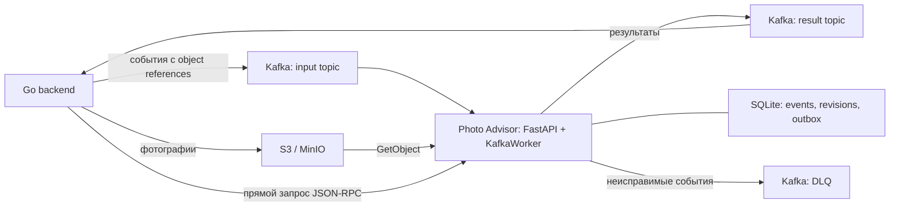

# Архитектура Photo Advisor

Состояние кода на 04.11.2026. Это отдельный Python-сервис с локальным CV, HTTP API и включаемым Kafka-обработчиком. Внутренние модули работают в одном процессе; обучение и интерфейс разметки запускаются отдельно.

## Границы ответственности

Go backend отвечает за пользователя, проверку владельца объявления, сохранение файлов и назначение ревизий событий. Python-сервис получает ссылки на приватные объекты и определяет покрытие 12 обязательных ракурсов. Бинарные изображения через Kafka не передаются.

Схема описывает реализованные точки интеграции, а не подтверждённое подключение к конкретному работающему Go backend. Адреса Kafka/S3, темы, credentials и включение режима задаются окружением. По умолчанию `KAFKA_ENABLED=false`, `CV_BACKEND=clip`; экспериментальный обученный классификатор выбирается явно через `CV_BACKEND=trained` и `TRAINED_MODEL_DIR`.

## Выполнение запроса

1. В асинхронном режиме `KafkaWorker` читает событие, проверяет контракт и ревизию. События одного объявления используют одинаковый Kafka key.
2. Финализация `photoset.finalized` содержит полный авторитетный набор снимков. Она запускает анализ набора; изменения отдельных файлов не заставляют преждевременно объявлять ракурсы отсутствующими.
3. S3-адаптер загружает разрешённые объекты. `version_id` или `etag` фиксируют содержимое. Bucket и область ключей ограничиваются конфигурацией.
4. Подготовка изображений исправляет EXIF-ориентацию, переводит их в RGB, ограничивает размер и проверяет качество. Сервис обнаруживает точные и близкие дубликаты.
5. Общий экземпляр модели выполняет локальный inference. Правила собирают найденные, недостающие и неопределённые ракурсы. Ручная корректировка из события учитывается явно.
6. Результат, обработанное событие и запись outbox сохраняются транзакционно в SQLite. Отправка из outbox допускает повторную доставку; downstream должен учитывать ID результата. Это не обещание глобального exactly-once.
7. Временные ошибки повторяются ограниченно, неисправимые события отправляются в DLQ. Состояние восстанавливается после перезапуска из постоянного тома.

Прямой режим использует `POST /rpc`, JSON-RPC 2.0 и Bearer service token. Он возвращает результат в HTTP-ответе. Доступны `/health/live` и `/health/ready`.

## Модули

| Модуль | Ответственность |
|---|---|
| `app/main.py` | FastAPI, авторизация, JSON-RPC, жизненный цикл модели и worker, health endpoints |
| `app/consumer.py` | aiokafka consumer/producer, повторы, DLQ, отправка outbox |
| `app/pipeline.py` | События объявления, финализация, ручные категории, сбор результата |
| `app/state.py` | SQLite WAL: идемпотентность, ревизии, результаты, outbox и очередь обратной связи |
| `app/storage.py` | Read-only загрузки S3 через boto3, область ключей и ограничения |
| `app/service.py` | Координация загрузки, анализа и обработки отдельных ошибок |
| `app/imaging.py` | Декодирование, качество, fingerprints и сравнение дубликатов |
| `app/inference.py` | Выбор CV backend; исходный CLIP + дополнительная детекция |
| `app/trained.py` | Обученные классификаторы, загрузка весов, оценки и допуск классов |
| `app/rules.py`, `app/policy.py` | Покрытие требований, рекомендации и политика принятия |
| `app/review.py` | Отдельное локальное приложение разметки с собственной SQLite и историей |
| `app/pilot.py`, `app/pilot.html` | Локальный пилот с загрузкой фото, настоящим Advisor, ручными решениями и отдельной SQLite; запуск `scripts/pilot.py` |
| `scripts/` | Сбор данных, обучение, подбор параметров, оценка и проверки |

## Текущая CV-модель

Экспериментальный выбранный вариант — `models/view-classifier-triple-v19-apache-balanced` (05.11.2026). Предыдущий v15 сохранён. Модель объединяет глобальные и пространственные признаки CLIP ViT-B/32, MobileNetV3-Small v7 и DINOv2-Small. Линейная голова выбирает одну из 12 категорий либо технический `other`; смещение логита other выбрано только на calibration. Выбор не включает производственный допуск. Результаты и ограничения: `reports/training-v19-result.md`.

Модель загружается один раз при старте процесса, работает локально на CPU. Веса проверяются по SHA256 и загружаются через mmap с созданием структуры на `meta`, без временной полной копии кодировщика. Детерминированные служебные буферы CLIP восстанавливаются явно. У v19 измеренный RSS после прогрева около 774 МиБ, медиана около 0,27 с/кадр на двух CPU-потоках. Во время замера работали другие проверки; это не гарантия latency или максимальной памяти всего сервиса.

Softmax score не считается вероятностью правильного ответа. Автоматическое подтверждение обученных категорий выключено: достаточной независимой человеческой проверки всех 12 классов нет. Неподтверждённый кандидат остаётся `uncertain` или `unknown`.

## Развёртывание и масштабирование

Локальный пилот работает отдельно от production-потока, на `127.0.0.1:8766`: браузер → FastAPI пилота → локальные нормализованные JPEG → тот же Advisor/TrainedVision. SQLite пилота сохраняет проверки, первоначальные результаты, решения и их историю. Экспорт разрешён отдельно для каждой проверки; обратная связь помечена как model-assisted и не принимается trainer без проверки/импорта. Пилот не подключается к Kafka/S3 и не заменяет слепую разметку. Инструкция и проверки: `PILOT.md`.

Docker Compose содержит сервис, read-only том весов и постоянный том состояния; MinIO доступен отдельным локальным профилем. Внешние Kafka/S3 не создаются самим приложением. В Compose заданы ограничения 2 CPU и 3 ГиБ, но фактическая нагрузка требует измерений.

Один процесс владеет конкретным SQLite-файлом через файловую блокировку. Текущая реализация рассчитана на один такой экземпляр; запуск нескольких workers/реплик на общей базе не поддерживается. Для горизонтального масштабирования нужно спроектировать общее транзакционное состояние, согласование ревизий при смене владельца Kafka partition и outbox. Простое увеличение числа Uvicorn workers эту задачу не решает.

Подробный контракт событий: `contracts/kafka.md`. Данные и критерии качества: `datasets/QUALITY_WORKFLOW.md`. Последние проверки модели и памяти: `reports/training-v19-result.md`; сравнение загрузчиков: `reports/training-v12-result.md`.
